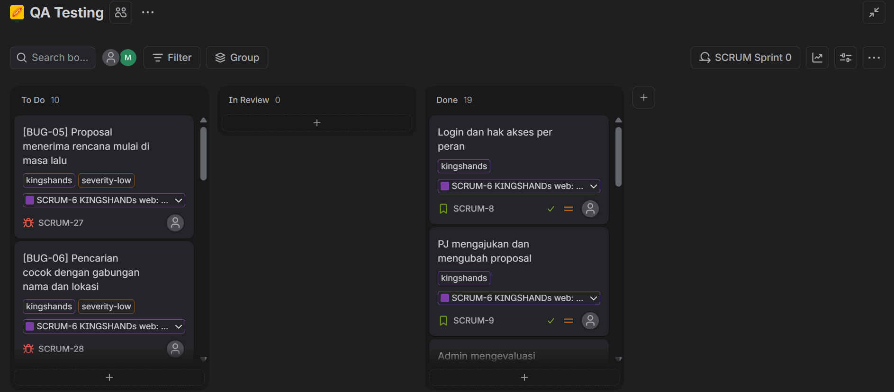
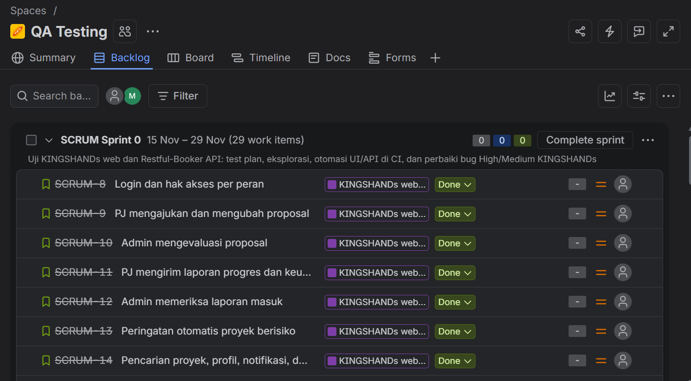
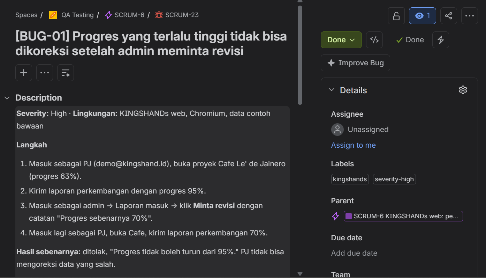
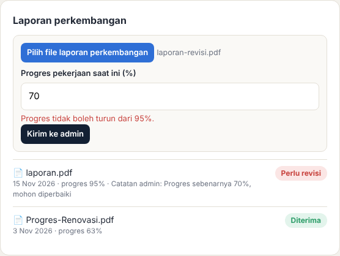
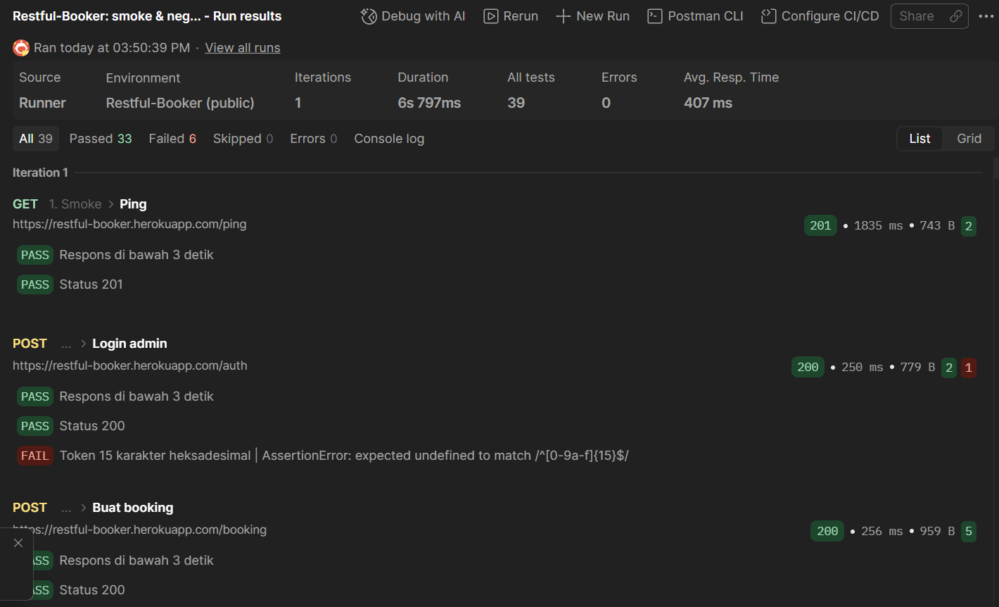

# QA Automation Portfolio

Pengujian manual dan otomatis untuk dua aplikasi: **KINGSHANDs** (aplikasi web monitoring proyek pendanaan, UI) dan **Restful-Booker** (REST API latihan). Lengkap dari test plan, pengujian eksploratif, laporan bug di Jira, perbaikan, sampai test regresi yang berjalan di CI.

**[Laporan test terbaru](https://rivaldimhr.github.io/qa-automation-portfolio/)** · **[Test plan](docs/test-plan.md)** · **[Test case](docs/test-cases.md)** · **[Laporan bug](docs/bug-reports.md)** · **[Catatan eksploratif](docs/exploratory-testing.md)**

## Penjelasan sederhana

**Apa itu QA?** Quality Assurance (QA) adalah pekerjaan memastikan sebuah aplikasi bekerja sesuai yang diharapkan sebelum dipakai orang banyak. Caranya dengan mencoba aplikasi secara sistematis, mencari kesalahan (bug), melaporkannya, lalu memastikan perbaikannya benar.

**Apa yang saya uji?**

- **King's Hand:** website untuk memantau proyek yang didanai. Penanggung jawab proyek mengajukan proposal dan melaporkan kemajuan; admin menyetujui proposal dan memeriksa laporan. Website juga memberi peringatan otomatis, misalnya kalau uang terpakai lebih cepat daripada pekerjaannya.
- **Restful-Booker:** API pemesanan hotel. API adalah "jalur komunikasi" antaraplikasi, misalnya saat aplikasi travel mengirim data pemesanan ke sistem hotel. Restful-Booker memang dibuat untuk latihan pengujian.

**Langkah yang saya lakukan:**

1. **Membuat rencana pengujian:** apa yang diuji, bagaimana caranya, dan kapan pengujian dianggap selesai.
2. **Mencoba aplikasi seperti pengguna sungguhan** untuk mencari kesalahan, termasuk skenario yang tidak biasa (misalnya salah ketik lalu ingin memperbaikinya).
3. **Mencatat setiap kesalahan di Jira,** aplikasi pelacak pekerjaan yang dipakai tim software: langkah untuk mengulanginya, hasil yang seharusnya, tingkat keparahan, dan screenshot.
4. **Memperbaiki kesalahan yang penting,** lalu membuat test otomatis supaya kesalahan yang sama tidak muncul lagi.
5. **Membuat "robot penguji"** yang setiap hari otomatis mencoba 115 skenario dan menerbitkan laporannya.

**Contoh kesalahan yang ditemukan (bahasa sederhana):**

- Penanggung jawab salah mengetik progres 95% (seharusnya 70%). Admin sudah meminta revisi, tetapi aplikasi menolak koreksinya karena "progres tidak boleh turun". Data yang salah terkunci. *(Sudah diperbaiki.)*
- Proyek yang menghabiskan uang 108% dari anggaran malah ditandai "Proyek ini aman". *(Sudah diperbaiki.)*
- Di API hotel, status "belum bayar deposit" yang dikirim sebagai teks `"false"` tersimpan sebagai "sudah bayar". *(Dilaporkan; aplikasi pihak ketiga.)*

**Hasilnya:** 14 kesalahan ditemukan. 4 yang paling serius sudah diperbaiki dan dijaga test otomatis; 10 sisanya tercatat di Jira dan tetap dipantau oleh test.

**Istilah yang dipakai:**

| Istilah | Artinya |
|---|---|
| Test case | Satu skenario uji: langkah yang dilakukan dan hasil yang diharapkan |
| Bug | Kesalahan di aplikasi: hasil sebenarnya berbeda dari yang seharusnya |
| Severity | Tingkat keparahan bug: High (alur utama rusak), Medium, Low (kecil) |
| Pengujian eksploratif | Mencoba aplikasi secara bebas tapi terarah untuk menemukan kesalahan yang tidak terpikirkan sebelumnya |
| Test otomatis | Program yang menjalankan skenario uji sendiri, tanpa diklik manual |
| Test regresi | Test yang memastikan bug yang sudah diperbaiki tidak muncul lagi |
| CI (Continuous Integration) | Server yang menjalankan semua test otomatis setiap ada perubahan dan setiap hari |
| xfail | Test untuk bug yang belum diperbaiki: sengaja "gagal sesuai dugaan" sampai bugnya diperbaiki |
| Playwright / Postman | Alat untuk menguji website (Playwright) dan API (Postman) secara otomatis |
| Jira | Aplikasi untuk mencatat dan melacak pekerjaan dan bug dalam tim |

## Hasil singkat

| | |
|---|---|
| Test case | 64 (115 eksekusi): 40 UI, 24 API, ditambah koleksi Postman 14 request / 39 asersi |
| Bug ditemukan | 14: 8 di KINGSHANDs, 6 di Restful-Booker |
| Bug diperbaiki | 4 bug KINGSHANDs (1 High, 3 Medium), masing-masing dengan test regresi yang dibuktikan gagal di versi lama |
| Bug terbuka | 10, masing-masing tercatat di Jira dan punya test `xfail` |
| Pelacakan | Jira: 2 epic, 10 story, 5 task, 14 bug dalam satu sprint. Board Jira bersifat privat; isi setiap tiket juga ada di [laporan bug](docs/bug-reports.md) dan [test case](docs/test-cases.md) |
| CI | GitHub Actions setiap push dan setiap hari pukul 06.00 WIB |

## Jira

Sprint berisi 2 epic, 10 story (dengan kriteria penerimaan dan ID test case), 5 task, dan 14 bug. Bug yang sudah diperbaiki dan semua story/task ada di Done; 10 bug terbuka ada di To Do. Setiap bug terhubung ke story yang terdampak.



Backlog sprint dengan sprint goal:



Contoh tiket bug (BUG-01 / SCRUM-23): severity, lingkungan, langkah reproduksi, hasil sebenarnya dan yang diharapkan, akar masalah, perbaikan, dan test yang memverifikasinya.



## Alur kerja QA

```
Requirement ─► Test plan ─► Pengujian eksploratif ─► Bug di Jira ─► Perbaikan ─► Test regresi
                  │                (4 sesi, charter)       (bukti + langkah)              │
                  └──► Test case (EP, BVA, state transition, negative) ─► Otomasi ─► CI ──┘
```

Contoh nyata dari alur ini, **BUG-01 (High)**: saat pengujian eksploratif, penanggung jawab yang salah melaporkan progres 95% tidak bisa mengoreksinya ke 70% walaupun admin sudah meminta revisi, karena nilai yang salah itu dipakai sebagai batas bawah. Bug dilaporkan dengan langkah dan screenshot, diperbaiki di [repo KINGSHANDs](https://github.com/rivaldimhr/KINGSHANDs), lalu dijaga dua test regresi (KH-27, KH-27b) yang terbukti gagal di versi lama dan lulus di versi baru.



## Postman

Koleksi yang sama juga tersedia di workspace Postman dengan dua environment (publik dan lokal), dan bisa dijalankan dengan Collection Runner.



Run di atas dijalankan ke server publik `restful-booker.herokuapp.com`: 39 asersi, 33 lulus dan 6 gagal. Keenam kegagalan itu satu akar masalah, dan ditelusuri dari request **Login admin**: status 200 tetapi tanpa token. Variabel `password` di environment dibuat bertipe *secret* lewat API, dan nilainya tidak tersinkron ke aplikasi, sehingga yang terkirim kosong. Lima kegagalan lain (ubah, hapus, baca setelah dihapus) adalah efek berantai karena butuh token. Variabelnya sudah diubah ke tipe biasa (kredensial demo yang memang publik). Di CI, koleksi yang sama lulus 39/39 terhadap server lokal.

## Bug terbuka tetap diuji

Bug yang belum diperbaiki ditulis sebagai test dengan perilaku yang **benar**, lalu ditandai `xfail` strict:

```python
@known_bug("BUG-11")
def test_rb34_depositpaid_teks_false_tidak_menjadi_true(api, token):
    r = api.create(booking(depositpaid="false"))
    ...
    assert r.status_code == 400 or r.json()["booking"]["depositpaid"] is False
```

Selama bug ada, test ini "gagal sesuai dugaan" dan pipeline tetap hijau. Begitu bug diperbaiki, test lulus, pytest melaporkannya sebagai XPASS, dan pipeline **gagal**. Itu tanda untuk melepas penanda dan menutup tiket Jira. Daftar bug ada di [`bugs.py`](bugs.py), satu sumber untuk test, laporan, dan halaman ringkasan.

## Struktur

```
ui/
  pages/            Page Object Model: login, dashboard, proyek, detail, proposal, admin, profil
  tests/            40 test case UI (Playwright + pytest)
  data.py           data uji dan tanggal relatif
  conftest.py       server lokal, browser baru per test, screenshot saat gagal
api/
  client.py         klien Restful-Booker
  data.py           pembuat data booking dan JSON schema
  tests/            24 test case API (pytest + requests + jsonschema)
postman/            koleksi Postman + environment lokal dan publik
docs/               test plan, test case, laporan bug, catatan eksploratif, screenshot bukti
bugs.py             daftar bug + penanda known_bug / regression_for
scripts/            halaman ringkasan laporan
.github/workflows/  pipeline QA
```

## Menjalankan sendiri

Butuh Python 3.10+, dan Node 18+ untuk Restful-Booker dan Newman.

```bash
pip install -r requirements.txt
python -m playwright install chromium

# Aplikasi yang diuji
git clone https://github.com/rivaldimhr/KINGSHANDs sut/KINGSHANDs
git clone https://github.com/mwinteringham/restful-booker sut/restful-booker
(cd sut/restful-booker && npm ci && npm start &)      # http://localhost:3001

# Test
python -m pytest ui -v                      # UI, atau KH_URL=https://rivaldimhr.github.io/kingshand/ untuk versi online
python -m pytest api -v                     # API, atau RB_URL=https://restful-booker.herokuapp.com
python -m pytest -m smoke                   # hanya smoke test
python -m pytest --html=reports/index.html  # dengan laporan HTML

# Postman
npx newman run postman/restful-booker.postman_collection.json -e postman/local.postman_environment.json
```

Koleksi Postman bisa juga diimpor langsung ke aplikasi Postman (Import → pilih kedua file di folder `postman/`), lalu dijalankan dengan Collection Runner.

## Teknik dan alat

- **Desain test:** equivalence partitioning, boundary value analysis (misalnya batas peringatan dana 14 vs 15 poin, anggaran 100% vs 101%), state transition, negative testing, pengujian eksploratif berbasis sesi.
- **UI:** Playwright, pytest, Page Object Model, parametrisasi data, screenshot otomatis saat gagal, pemeriksaan error JavaScript di setiap test, uji tampilan ponsel.
- **API:** requests, validasi JSON schema, autentikasi token (cookie) dan Basic auth, header Accept, Postman (variabel koleksi, test script, environment) dan Newman.
- **Proses:** Jira (epic, story dengan kriteria penerimaan, task, bug dengan severity, sprint), laporan bug dengan langkah reproduksi dan bukti, test regresi untuk setiap perbaikan.
- **CI:** GitHub Actions, Restful-Booker dijalankan dari versi yang dikunci, laporan pytest-html dan Newman htmlextra dipublikasikan ke GitHub Pages.
