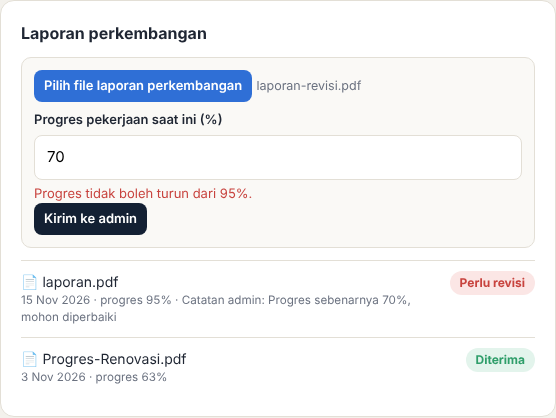
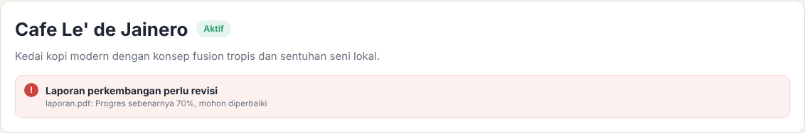
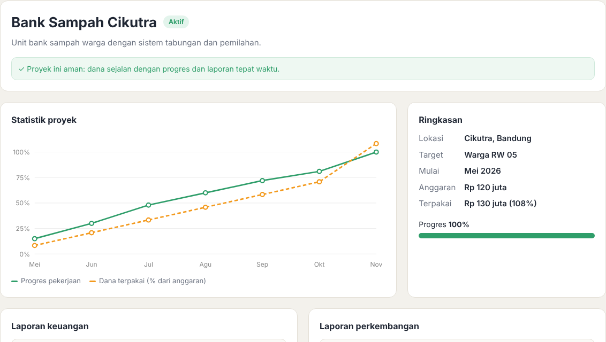
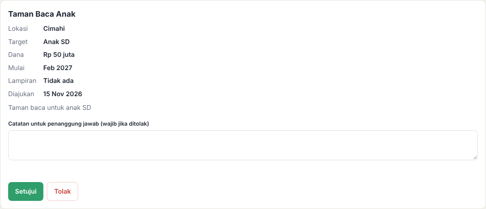
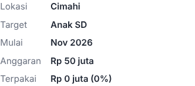
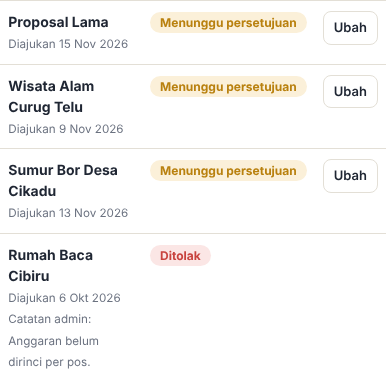
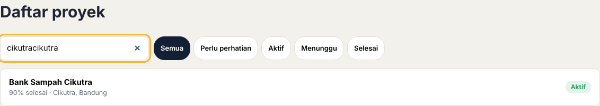
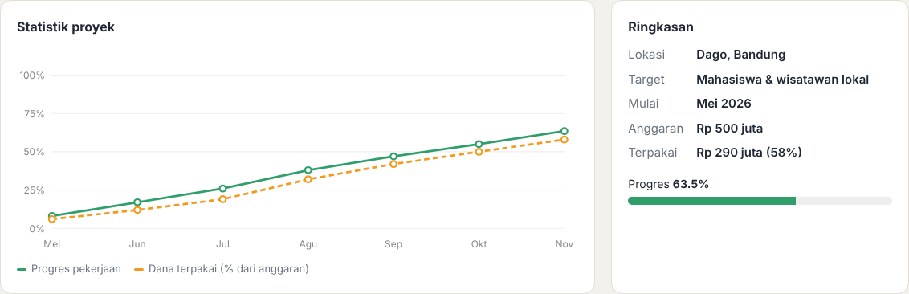
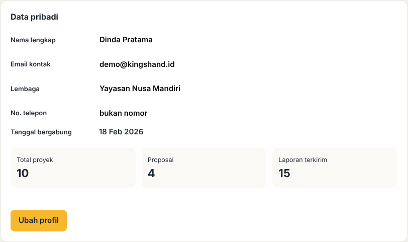

# Laporan bug

14 bug: 8 di KINGSHANDs (4 diperbaiki, 4 terbuka) dan 6 di Restful-Booker (semua terbuka; Restful-Booker adalah aplikasi latihan pihak ketiga yang sengaja berisi bug).

Setiap bug direproduksi dengan script sebelum dilaporkan. Setiap bug terbuka punya test dengan perilaku yang benar, ditandai `xfail` strict; setiap bug yang diperbaiki punya test regresi yang sudah dibuktikan gagal pada versi sebelum perbaikan.

| ID | Jira | Aplikasi | Ringkasan | Severity | Status | Test |
|---|---|---|---|---|---|---|
| BUG-01 | [SCRUM-23](https://mochiii762025.atlassian.net/browse/SCRUM-23) | KINGSHANDs | Progres yang terlalu tinggi tidak bisa dikoreksi setelah admin meminta revisi | High | Diperbaiki | KH-27, KH-27b |
| BUG-02 | [SCRUM-24](https://mochiii762025.atlassian.net/browse/SCRUM-24) | KINGSHANDs | Peringatan "perlu revisi" tidak hilang setelah laporan pengganti diterima | Medium | Diperbaiki | KH-28 |
| BUG-03 | [SCRUM-25](https://mochiii762025.atlassian.net/browse/SCRUM-25) | KINGSHANDs | Dana terpakai melebihi anggaran ditandai "Proyek ini aman" | Medium | Diperbaiki | KH-34 |
| BUG-04 | [SCRUM-26](https://mochiii762025.atlassian.net/browse/SCRUM-26) | KINGSHANDs | Rencana bulan mulai diganti bulan persetujuan | Medium | Diperbaiki | KH-17 |
| BUG-05 | [SCRUM-27](https://mochiii762025.atlassian.net/browse/SCRUM-27) | KINGSHANDs | Proposal menerima rencana mulai di masa lalu | Low | Terbuka | KH-18 |
| BUG-06 | [SCRUM-28](https://mochiii762025.atlassian.net/browse/SCRUM-28) | KINGSHANDs | Pencarian cocok dengan gabungan nama dan lokasi | Low | Terbuka | KH-42 |
| BUG-07 | [SCRUM-29](https://mochiii762025.atlassian.net/browse/SCRUM-29) | KINGSHANDs | Progres laporan menerima angka desimal | Low | Terbuka | KH-29 |
| BUG-08 | [SCRUM-30](https://mochiii762025.atlassian.net/browse/SCRUM-30) | KINGSHANDs | No. telepon profil menerima huruf | Low | Terbuka | KH-45 |
| BUG-09 | [SCRUM-31](https://mochiii762025.atlassian.net/browse/SCRUM-31) | Restful-Booker | Login gagal mengembalikan 200 OK, bukan 401 | Medium | Terbuka | RB-05 |
| BUG-10 | [SCRUM-32](https://mochiii762025.atlassian.net/browse/SCRUM-32) | Restful-Booker | Data tidak lengkap dijawab 500 lewat POST, tapi 400 lewat PUT | Medium | Terbuka | RB-31 |
| BUG-11 | [SCRUM-33](https://mochiii762025.atlassian.net/browse/SCRUM-33) | Restful-Booker | `depositpaid: "false"` (teks) tersimpan sebagai `true` | High | Terbuka | RB-34 |
| BUG-12 | [SCRUM-34](https://mochiii762025.atlassian.net/browse/SCRUM-34) | Restful-Booker | Checkout sebelum checkin diterima | Medium | Terbuka | RB-35 |
| BUG-13 | [SCRUM-35](https://mochiii762025.atlassian.net/browse/SCRUM-35) | Restful-Booker | DELETE berhasil mengembalikan 201 Created | Low | Terbuka | RB-25 |
| BUG-14 | [SCRUM-36](https://mochiii762025.atlassian.net/browse/SCRUM-36) | Restful-Booker | Ubah/hapus booking yang tidak ada mengembalikan 405, bukan 404 | Low | Terbuka | RB-26 |

Pertanyaan yang bukan bug:

| ID | Pertanyaan | Alasan |
|---|---|---|
| Q-01 | Apakah lampiran PDF proposal wajib? | Proposal bisa diajukan tanpa lampiran dan admin melihat "Lampiran: Tidak ada". Form tidak menyebut wajib atau opsional, jadi ini keputusan produk, bukan cacat. |

Lingkungan KINGSHANDs: Chromium (Playwright), desktop 1280×860, data contoh bawaan, versi web sebelum commit `a4641d6`. Akun: PJ `demo@kingshand.id`, admin `admin@kingshand.id`.
Lingkungan Restful-Booker: commit `619d031`, Node 24, lokal di port 3001.

---

## BUG-01: Progres yang terlalu tinggi tidak bisa dikoreksi setelah admin meminta revisi

**Jira:** [SCRUM-23](https://mochiii762025.atlassian.net/browse/SCRUM-23) · **Severity:** High · **Prioritas:** Highest · **Status:** Diperbaiki di KINGSHANDs `a4641d6`

**Langkah**
1. Masuk sebagai PJ, buka proyek Cafe Le' de Jainero (progres 63%).
2. Kirim laporan perkembangan dengan progres 95% (misalnya salah ketik).
3. Masuk sebagai admin → Laporan masuk → pada laporan itu klik **Minta revisi** dengan catatan "Progres sebenarnya 70%".
4. Masuk lagi sebagai PJ, buka Cafe, kirim laporan perkembangan 70%.

**Hasil sebenarnya:** ditolak dengan pesan "Progres tidak boleh turun dari 95%." PJ hanya bisa mengirim ≥ 95%, jadi data yang salah tidak bisa dikoreksi.

**Hasil yang diharapkan:** koreksi 70% diterima, karena laporan 95% belum sah (sedang diminta revisi). Nilai di bawah progres terakhir yang sudah diterima admin (63%) tetap ditolak.



**Akar masalah:** batas bawah validasi memakai nilai progres terakhir, termasuk nilai dari laporan yang sedang diminta revisi.
**Perbaikan:** jika laporan terakhir berstatus "Perlu revisi", batas bawahnya adalah nilai sebelum laporan itu.
**Verifikasi:** KH-27 dan KH-27b lulus di versi baru dan gagal di versi lama.

## BUG-02: Peringatan "perlu revisi" tidak hilang setelah laporan pengganti diterima

**Jira:** [SCRUM-24](https://mochiii762025.atlassian.net/browse/SCRUM-24) · **Severity:** Medium · **Prioritas:** High · **Status:** Diperbaiki di KINGSHANDs `a4641d6`

**Langkah**
1. Admin meminta revisi laporan perkembangan sebuah proyek.
2. PJ mengirim laporan pengganti.
3. Admin menerima laporan pengganti.
4. Buka halaman proyek atau dashboard.

**Hasil sebenarnya:** peringatan "Laporan perkembangan perlu revisi" tetap tampil selamanya, dan proyek tetap dihitung "perlu perhatian".

**Hasil yang diharapkan:** setelah laporan pengganti dikirim, laporan lama tidak lagi memicu peringatan.



**Akar masalah:** peringatan dibuat dari semua laporan berstatus "revisi", dan status itu tidak pernah berubah.
**Perbaikan:** saat laporan baru dikirim, laporan lama berstatus "revisi" diubah menjadi "Diganti laporan baru".
**Verifikasi:** KH-28.

## BUG-03: Dana terpakai melebihi anggaran ditandai "Proyek ini aman"

**Jira:** [SCRUM-25](https://mochiii762025.atlassian.net/browse/SCRUM-25) · **Severity:** Medium · **Prioritas:** High · **Status:** Diperbaiki di KINGSHANDs `a4641d6`

**Langkah**
1. Masuk sebagai PJ, buka Bank Sampah Cikutra (anggaran Rp 120 juta).
2. Kirim laporan perkembangan 100%.
3. Kirim laporan keuangan dengan dana terpakai Rp 130 juta.

**Hasil sebenarnya:** ringkasan menulis "Rp 130 juta (108%)", tetapi kotak peringatan menulis "✓ Proyek ini aman: dana sejalan dengan progres".

**Hasil yang diharapkan:** proyek yang melebihi anggaran ditandai perlu perhatian.



**Akar masalah:** satu-satunya aturan dana adalah selisih dana−progres ≥ 15 poin. Dengan progres 100%, dana harus ≥ 115% agar terpicu.
**Perbaikan:** aturan baru "Dana terpakai melebihi anggaran" untuk dana > 100%.
**Verifikasi:** KH-34 dengan nilai batas 100% (tidak ada peringatan), 101%, dan 108%.

## BUG-04: Rencana bulan mulai diganti bulan persetujuan

**Jira:** [SCRUM-26](https://mochiii762025.atlassian.net/browse/SCRUM-26) · **Severity:** Medium · **Prioritas:** Medium · **Status:** Diperbaiki di KINGSHANDs `a4641d6`

**Langkah**
1. PJ mengajukan proposal dengan rencana mulai 3 bulan dari sekarang.
2. Admin melihat kartu evaluasi (Mulai: sesuai rencana) lalu menyetujui.
3. Buka detail proyek.

**Hasil sebenarnya:** "Mulai" berubah menjadi bulan persetujuan. Rencana PJ hilang tanpa pemberitahuan.

**Hasil yang diharapkan:** bulan mulai tetap sesuai rencana; jika rencana sudah lewat, proyek mulai bulan ini.

| Sebelum disetujui | Sesudah disetujui |
|---|---|
|  |  |

**Akar masalah:** persetujuan selalu menulis `start = bulan ini`.
**Verifikasi:** KH-17.

## BUG-05: Proposal menerima rencana mulai di masa lalu

**Jira:** [SCRUM-27](https://mochiii762025.atlassian.net/browse/SCRUM-27) · **Severity:** Low · **Prioritas:** Low · **Status:** Terbuka

**Langkah:** ajukan proposal dengan rencana mulai Januari 2019.
**Hasil sebenarnya:** proposal diterima tanpa peringatan. **Diharapkan:** pesan bahwa rencana mulai tidak boleh sebelum bulan ini.

**Test:** KH-18 (xfail).

## BUG-06: Pencarian cocok dengan gabungan nama dan lokasi

**Jira:** [SCRUM-28](https://mochiii762025.atlassian.net/browse/SCRUM-28) · **Severity:** Low · **Prioritas:** Low · **Status:** Terbuka

**Langkah:** di halaman Proyek, cari `cikutracikutra`.
**Hasil sebenarnya:** Bank Sampah Cikutra ditemukan, padahal teks itu tidak ada di nama maupun lokasinya. Nama dan lokasi digabung tanpa pemisah sebelum dicocokkan.
**Diharapkan:** "Tidak ada proyek yang cocok."

**Test:** KH-42 (xfail).

## BUG-07: Progres laporan menerima angka desimal

**Jira:** [SCRUM-29](https://mochiii762025.atlassian.net/browse/SCRUM-29) · **Severity:** Low · **Prioritas:** Low · **Status:** Terbuka

**Langkah:** kirim laporan perkembangan dengan progres `63.5`.
**Hasil sebenarnya:** tersimpan dan tampil "63.5%", padahal kolom memakai `step="1"` dan semua progres lain bilangan bulat.
**Diharapkan:** pesan validasi, atau dibulatkan secara konsisten.

**Test:** KH-29 (xfail).

## BUG-08: No. telepon profil menerima huruf

**Jira:** [SCRUM-30](https://mochiii762025.atlassian.net/browse/SCRUM-30) · **Severity:** Low · **Prioritas:** Lowest · **Status:** Terbuka

**Langkah:** Profil → Ubah → isi No. telepon "bukan nomor" → Simpan.
**Hasil sebenarnya:** tersimpan. **Diharapkan:** hanya angka, spasi, tanda hubung, dan `+`.

**Test:** KH-45 (xfail).

---

## BUG-09: Login gagal mengembalikan 200 OK, bukan 401

**Jira:** [SCRUM-31](https://mochiii762025.atlassian.net/browse/SCRUM-31) · **Severity:** Medium · **Status:** Terbuka

```http
POST /auth
{"username": "admin", "password": "salah"}

HTTP/1.1 200 OK
{"reason": "Bad credentials"}
```

**Diharapkan:** `401 Unauthorized`. Klien yang hanya memeriksa kode status akan menganggap login berhasil.
**Test:** RB-05 (xfail). RB-04 memastikan token tidak diberikan.

## BUG-10: Data booking tidak lengkap dijawab 500 lewat POST, tapi 400 lewat PUT

**Jira:** [SCRUM-32](https://mochiii762025.atlassian.net/browse/SCRUM-32) · **Severity:** Medium · **Status:** Terbuka

Booking tanpa `firstname` (atau kolom wajib lain):

| Request | Status |
|---|---|
| `POST /booking` | `500 Internal Server Error` |
| `PUT /booking/{id}` | `400 Bad Request` |

**Diharapkan:** `400` untuk keduanya. 500 menandakan kesalahan server, bukan kesalahan input, dan memicu alarm monitoring yang salah.
**Test:** RB-31 (xfail); RB-32 memastikan PUT sudah 400.

## BUG-11: `depositpaid: "false"` (teks) tersimpan sebagai `true`

**Jira:** [SCRUM-33](https://mochiii762025.atlassian.net/browse/SCRUM-33) · **Severity:** High · **Status:** Terbuka

```http
POST /booking
{..., "depositpaid": "false", ...}

HTTP/1.1 200 OK
{"bookingid": <id>, "booking": {..., "depositpaid": true, ...}}
```

**Diharapkan:** `400` (tipe salah) atau tersimpan `false`. Saat ini tamu yang belum membayar deposit tercatat sudah membayar.
**Akar masalah (dari kode):** nilai diubah dengan `Boolean(...)`, dan `Boolean("false")` bernilai `true`.
**Test:** RB-34 (xfail); RB-33 memastikan boolean asli tersimpan benar.

## BUG-12: Checkout sebelum checkin diterima

**Jira:** [SCRUM-34](https://mochiii762025.atlassian.net/browse/SCRUM-34) · **Severity:** Medium · **Status:** Terbuka

`POST /booking` dengan `checkin: 2026-12-10`, `checkout: 2026-12-01` → `200 OK`. **Diharapkan:** `400`.
**Test:** RB-35 (xfail).

## BUG-13: DELETE berhasil mengembalikan 201 Created

**Jira:** [SCRUM-35](https://mochiii762025.atlassian.net/browse/SCRUM-35) · **Severity:** Low · **Status:** Terbuka

`DELETE /booking/{id}` → `201 Created`. **Diharapkan:** `200 OK` atau `204 No Content`; tidak ada resource yang dibuat.
**Test:** RB-25 (xfail); RB-24 memastikan booking benar-benar terhapus.

## BUG-14: Ubah/hapus booking yang tidak ada mengembalikan 405, bukan 404

**Jira:** [SCRUM-36](https://mochiii762025.atlassian.net/browse/SCRUM-36) · **Severity:** Low · **Status:** Terbuka

`PUT /booking/99999999` dan `DELETE /booking/99999999` (dengan token) → `405 Method Not Allowed`. Metodenya diizinkan; resource-nya yang tidak ada. **Diharapkan:** `404 Not Found`, sama seperti `GET`.
**Test:** RB-26 (xfail).
